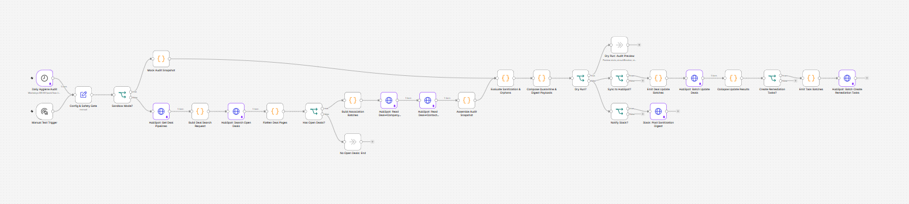

<div align="center">

# n8n-hubspot-orphan-deal-pipeline-sanitization-guard

**Scheduled audit workflow that detects unassociated deals, missing required property values, and abandoned pipeline records, routing them to a dedicated RevOps quarantine view and alerting staff.**

A dhRobin Systems Revenue Infrastructure blueprint

     

</div>

---

## Table of Contents

1. [Overview](#1-overview)
2. [Architecture](#2-architecture)
3. [Repository Contents](#3-repository-contents)
4. [Prerequisites](#4-prerequisites)
5. [5-Minute Sandbox Quick Start](#5-5-minute-sandbox-quick-start)
6. [Environment Variables](#6-environment-variables)
7. [Node-by-Node Configuration Guide](#7-node-by-node-configuration-guide)
8. [Rule Catalogue and Decision Model](#8-rule-catalogue-and-decision-model)
9. [Safety Matrix](#9-safety-matrix)
10. [Data Protection and Compliance](#10-data-protection-and-compliance)
11. [Deployment and Promotion Path](#11-deployment-and-promotion-path)
12. [Operations and Troubleshooting](#12-operations-and-troubleshooting)
13. [Extending the Guard](#13-extending-the-guard)
14. [Disclaimer and License](#14-disclaimer-and-license)

---

## 1. Overview

Forecasts break quietly. A deal with no company attached, no amount, or a close date three months in the past still counts toward pipeline coverage until someone notices. I built this guard to do the noticing: every morning it audits every open deal against an explicit hygiene contract, moves the offenders into a RevOps quarantine view, gives the owner a task with the exact fix, and tells the team what changed.

**On every scheduled run, the guard:**

1. **Loads pipeline metadata** to identify open stages, closed stages and the quarantine stage in each pipeline.
2. **Scans open deals** in the target pipelines through CRM Search with cursor pagination. That includes deals sitting in stages that no longer exist in their pipeline.
3. **Reads associations** for every deal through the v4 associations batch API (deal → company, deal → contact).
4. **Evaluates** each deal for orphaned records, missing required values, invalid pipeline or stage data, past close dates, and abandonment.
5. **Routes** the results: it sets a quarantine status (and optionally moves the deal to a quarantine stage), creates one remediation task per newly quarantined deal, clears deals that were fixed, and posts one Slack digest.

**Design principles**

| Principle | Implementation |
|---|---|
| Safe by default | With no environment variables set, the guard makes **zero external API calls and zero CRM writes**. |
| Least-invasive quarantine | The default `QUARANTINE_MODE=property` flags deals without touching `dealstage`. Stage moves are a separate opt-in. |
| Circuit breaker | If the run looks like a misconfiguration (too many new quarantines, a failed association read, an unresolvable quarantine stage), it writes nothing and alerts instead. |
| Fail closed on missing evidence | A failed association read stops the run. Missing data is never interpreted as "orphan". |
| Idempotent and quiet | Only deals whose hygiene state changed are written. Tasks are created only on the transition into quarantine. |
| Self-healing | Deals that become compliant are cleared automatically and can optionally be restored to their previous stage. |
| Secrets out of data | `HUBSPOT_PRIVATE_APP_TOKEN` and `SLACK_WEBHOOK_URL` appear only as `{{ $env.* }}` in HTTP header or URL fields. |

---

## 2. Architecture

```mermaid
flowchart LR
    T1[Daily Hygiene Audit<br/>0 5 * * 1-5] --> CFG
    T2[Manual Test Trigger] --> CFG
    CFG[Config & Safety Gate<br/>$env → config.*] --> SB{Sandbox Mode?}
    SB -- yes --> MK[Mock Audit Snapshot]
    SB -- no --> GP[HubSpot: Get<br/>Deal Pipelines]
    GP --> BS[Build Deal<br/>Search Request]
    BS --> SD[HubSpot: Search Open Deals<br/>cursor pagination]
    SD --> FL[Flatten Deal Pages]
    FL --> HD{Has Open Deals?}
    HD -- no --> NE[No Open Deals: End]
    HD -- yes --> AB[Build Association<br/>Batches ×100]
    AB --> AC[HubSpot: Read Deal→Company<br/>Associations v4]
    AC --> AT[HubSpot: Read Deal→Contact<br/>Associations v4]
    AT --> AS[Assemble Audit Snapshot]
    MK --> EV[Evaluate Sanitization<br/>& Orphans<br/>rules · severity · breaker]
    AS --> EV
    EV --> CP[Compose Quarantine<br/>& Digest Payloads]
    CP --> DR{Dry Run?}
    DR -- yes --> PV[Dry Run:<br/>Audit Preview]
    DR -- no --> SY{Sync to HubSpot?<br/>breaker closed}
    SY --> EU[Emit Deal<br/>Update Batches] --> BU[HubSpot: Batch<br/>Update Deals] --> CO[Collapse<br/>Update Results]
    CO --> CT{Create Remediation<br/>Tasks?} --> ET[Emit Task Batches] --> BT[HubSpot: Batch Create<br/>Remediation Tasks]
    DR -- no --> NS{Notify Slack?} --> SL[Slack: Post<br/>Sanitization Digest]
```





### Stage contracts

| Stage | Output |
|---|---|
| Mock Audit Snapshot / Assemble Audit Snapshot | One item: `{ source, pagesFetched, truncated, pipelines[], deals[], companyAssoc{dealId: [ids]}, contactAssoc{…}, assocErrors }` |
| Evaluate Sanitization & Orphans | One item: `{ stats, circuitBreaker{ open, reasons[] }, quarantineStages[], results[] }` |
| `results[]` entry | `{ id, dealname, pipelineLabel, stageLabel, ownerId, amount, idleDays, associations, issues[{ code, severity, label, detail }], maxSeverity, previousStatus, status, action, changed, newlyQuarantined, stageMove, stageRestore }` |
| Compose Quarantine & Digest Payloads | One item: `{ dryRun, syncToHubspot, notifySlack, circuitBreaker, counts, stats, updateBatches[][], taskBatches[][], slackPayload, results[] }` |

---

## 3. Repository Contents

```
n8n-hubspot-orphan-deal-pipeline-sanitization-guard/
├── README.md        Technical documentation (this file)
├── workflow.json    Importable n8n workflow with sticky notes and pinned synthetic payloads
├── DISCLAIMER.md    Liability limitation and usage terms
└── LICENSE          MIT License
```

---

## 4. Prerequisites

| Requirement | Detail |
|---|---|
| n8n | Self-hosted **1.60 or later** (Schedule Trigger 1.2, Set 3.4, IF 2, Code 2, HTTP Request 4.2, `v1` execution order). |
| Env access | `N8N_BLOCK_ENV_ACCESS_IN_NODE=false`. Recent n8n releases block `$env` in nodes by default, so set this explicitly. |
| HubSpot private app | Scopes: `crm.objects.deals.read`, `crm.objects.deals.write`, `crm.objects.companies.read`, `crm.objects.contacts.read` (association reads), plus the write scope HubSpot lists for the Tasks API on your account. Start in a developer test account or sandbox. |
| HubSpot properties | Seven custom deal properties (see [§7.12](#712-hubspot-custom-deal-properties)). |
| Quarantine stage (optional) | A stage such as *RevOps Quarantine* in each pipeline you want stage-mode quarantine for. Mark it as **open** (not closed won or lost). |
| Slack (optional) | An incoming webhook for an internal RevOps channel. |

> **n8n Cloud:** you can't define your own environment variables on n8n Cloud. Replace each `$env.X` with `$vars.X` (on plans with Variables) or move the secret into an n8n credential. The node logic is unchanged.

---

## 5. 5-Minute Sandbox Quick Start

1. **Run n8n locally:**
   ```bash
   docker run -it --rm -p 5678:5678 \
     -e N8N_BLOCK_ENV_ACCESS_IN_NODE=false \
     -e GENERIC_TIMEZONE=UTC \
     -v n8n_data:/home/node/.n8n \
     docker.n8n.io/n8nio/n8n
   ```
2. **Import** `workflow.json` (*Workflows → Import from File*).
3. Click **Test workflow** on *Manual Test Trigger*.
4. Open **Dry Run: Audit Preview** and inspect `stats`, `circuitBreaker`, `results`, `updateBatches`, `taskBatches` and `slackPayload`.

**Expected sandbox result** (nine synthetic deals, no credentials, nothing sent):

| Deal | Action | Highest severity | Rule(s) |
|---|---|---|---|
| SYN-001 Acme Corp · Platform Expansion | none | — | Fully compliant |
| SYN-002 Brightfield Labs · Pilot | quarantine | critical | `orphan_no_associations` |
| SYN-003 Calder Systems · Renewal | quarantine | high | `missing_amount`, `missing_close_date` |
| SYN-004 Dunmore Logistics · Upsell | quarantine | high | `close_date_past`, `abandoned` |
| SYN-005 Elmstead Freight · New Logo | quarantine | critical | `invalid_stage` |
| SYN-006 Fernhill Analytics · Expansion | quarantine | high | `missing_contact_association`, `missing_owner` |
| SYN-007 Granite Peak Retail · Trial | skipped | — | Inside `NEW_DEAL_GRACE_HOURS` |
| SYN-008 Harbor Lane Imports · Partner | clear | — | Previously quarantined, now compliant |
| SYN-009 Juniper Ridge Foods · Internal Test | skipped | — | `deal_hygiene_exempt = true` |

To preview stage-mode quarantine and automatic restore, add `QUARANTINE_MODE=stage`, `QUARANTINE_STAGE_ID=syn-quarantine-001` and `AUTO_RESTORE_REMEDIATED=true`, then run again. Four deals show a `stageMove`. SYN-003 stays property-flagged, because the Renewals pipeline has no quarantine stage. SYN-008 shows a `stageRestore` to `qualifiedtobuy`.

---

## 6. Environment Variables

All variables are optional. Unset values resolve to the safest behaviour.

### 6.1 Safety gate

| Variable | Default | Behaviour |
|---|---|---|
| `SANDBOX_MODE` | `true` | Any value except `false` uses the synthetic snapshot. Zero external calls. |
| `DRY_RUN` | `true` | Any value except `false` stops at *Dry Run: Audit Preview*. |
| `SYNC_TO_HUBSPOT` | `false` | Must be exactly `true` (with `DRY_RUN=false` and the circuit breaker closed) to write deals and tasks. |
| `CREATE_REMEDIATION_TASKS` | `true` | Effective only when `SYNC_TO_HUBSPOT=true`. |
| `NOTIFY_SLACK` | `false` | Must be exactly `true` (with `DRY_RUN=false`) to post the digest. The digest is also sent when the breaker is open. |

### 6.2 Quarantine

| Variable | Default | Description |
|---|---|---|
| `QUARANTINE_MODE` | `property` | `property`: set `deal_hygiene_status=quarantined` only. `stage`: also move the deal to the quarantine stage of its pipeline. |
| `QUARANTINE_STAGE_ID` | *(empty)* | A single stage ID, or a JSON map per pipeline, for example `{"default":"syn-quarantine-001","syn-pipeline-renewals":"syn-renewal-quarantine"}`. A stage is used only when it exists in the deal's pipeline. Otherwise the deal is property-flagged. |
| `QUARANTINE_MIN_SEVERITY` | `high` | `low`, `medium`, `high` or `critical`. Deals with issues below this severity are `flagged`, not quarantined. |
| `AUTO_RESTORE_REMEDIATED` | `false` | When `true`, a fixed deal in a quarantine stage returns to `deal_hygiene_previous_stage`. |
| `MAX_QUARANTINE_PER_RUN` | `25` | Circuit breaker: more new quarantines than this blocks all writes. |
| `CIRCUIT_BREAKER_PCT` | `40` | Circuit breaker: with 20 or more evaluated deals, a non-compliant share above this blocks all writes. |

### 6.3 Scan scope and rules

| Variable | Default | Description |
|---|---|---|
| `TARGET_PIPELINE_IDS` | *(all pipelines)* | Comma-separated pipeline IDs. Unknown IDs fail the run. |
| `REQUIRE_COMPANY_ASSOCIATION` | `true` | Enforce a deal → company association. |
| `REQUIRE_CONTACT_ASSOCIATION` | `true` | Enforce a deal → contact association. |
| `REQUIRED_PROPERTIES` | *(empty)* | Extra internal property names that must be populated, for example `dealtype,lead_source`. |
| `ALLOW_ZERO_AMOUNT` | `false` | When `false`, an amount of 0 is a `zero_amount` issue. |
| `CLOSE_DATE_GRACE_DAYS` | `0` | Days a close date may sit in the past before `close_date_past` fires. |
| `STALE_DAYS` | `45` | Idle days before `stale_no_activity`. More than twice this value fires `abandoned`. |
| `NEW_DEAL_GRACE_HOURS` | `48` | Deals younger than this are skipped while reps finish data entry. |
| `MAX_DEALS_SCANNED` | `5000` | 100–10,000 (HubSpot search ceiling). |

### 6.4 Routing and endpoints

| Variable | Default | Description |
|---|---|---|
| `TASK_DUE_HOURS` | `48` | Remediation task due time. |
| `REVOPS_DEFAULT_OWNER_ID` | *(empty)* | Owner for tasks on ownerless deals. |
| `HUBSPOT_PORTAL_ID` | *(empty)* | Enables record links in Slack. Not a secret. |
| `HUBSPOT_API_BASE_URL` | `https://api.hubapi.com` | API base. |
| `HUBSPOT_UI_BASE_URL` | `https://app.hubspot.com` | Use `https://app-eu1.hubspot.com` for EU portals. |

### 6.5 Secrets

| Variable | Used by | Placement |
|---|---|---|
| `HUBSPOT_PRIVATE_APP_TOKEN` | All HubSpot nodes | `Authorization: Bearer …` header |
| `SLACK_WEBHOOK_URL` | Slack: Post Sanitization Digest | URL field |

### 6.6 Sample `.env` (staging)

```dotenv
# n8n runtime
N8N_BLOCK_ENV_ACCESS_IN_NODE=false
GENERIC_TIMEZONE=UTC

# Safety gate: live read against a HubSpot test portal, nothing written yet
SANDBOX_MODE=false
DRY_RUN=true
SYNC_TO_HUBSPOT=false
CREATE_REMEDIATION_TASKS=true
NOTIFY_SLACK=false

# Secrets (inject from your secret manager; never commit)
HUBSPOT_PRIVATE_APP_TOKEN=replace-with-test-portal-token
SLACK_WEBHOOK_URL=https://hooks.slack.example/services/REPLACE/ME

# Quarantine
QUARANTINE_MODE=property
QUARANTINE_STAGE_ID=
QUARANTINE_MIN_SEVERITY=high
AUTO_RESTORE_REMEDIATED=false
MAX_QUARANTINE_PER_RUN=25
CIRCUIT_BREAKER_PCT=40

# Rules
TARGET_PIPELINE_IDS=default
REQUIRED_PROPERTIES=dealtype
STALE_DAYS=45
NEW_DEAL_GRACE_HOURS=48
HUBSPOT_PORTAL_ID=99000001
```

---

## 7. Node-by-Node Configuration Guide

### 7.1 Daily Hygiene Audit / Manual Test Trigger
- Cron `0 5 * * 1-5` (weekdays 05:00), so the quarantine view is current before the first pipeline review. Use `0 5 * * 1` for weekly.
- The workflow imports **inactive**. Activate it only after completing [§11.2](#112-promotion-path).
- **Pinned:** a synthetic schedule event.

### 7.2 Config & Safety Gate
Set v3.4 holding typed, non-secret configuration under `config.*`. Safety flags stay on unless set to exactly `false`, write flags stay off unless set to exactly `true`, enumerations fall back to their safe default, and numbers are clamped.

### 7.3 HubSpot: Get Deal Pipelines
- `GET /crm/v3/pipelines/deals`. Supplies each stage's `metadata.isClosed` and validates `QUARANTINE_STAGE_ID` against real stages.
- **Pinned:** two synthetic pipelines (*Sales Pipeline* with a `syn-quarantine-001` stage, and *Renewals* without one).

### 7.4 Build Deal Search Request
This node builds up to three OR'ed filter groups:

| Group | Filters | Catches |
|---|---|---|
| 1 | `pipeline IN targets` AND `dealstage IN openStages` | Normal open deals, including the quarantine stage |
| 2 | `pipeline IN targets` AND `dealstage NOT_IN allKnownStages` | Deals stuck on deleted or foreign stages |
| 3 | `pipeline NOT_IN allPipelines` (only when `TARGET_PIPELINE_IDS` is empty) | Deals on deleted pipelines |

Closed won and closed lost deals are never scanned. Requested properties are `dealname`, `amount`, `closedate`, `dealstage`, `pipeline`, `hubspot_owner_id`, `createdate`, `hs_lastmodifieddate`, `notes_last_updated`, `notes_last_contacted`, the four `deal_hygiene_*` state properties, and any `REQUIRED_PROPERTIES`.

### 7.5 HubSpot: Search Open Deals
- `POST /crm/v3/objects/deals/search`, sorted by `hs_object_id`, 100 per page.
- **Pagination:** `after` cursor in the body, 300 ms between pages, at most 100 pages (HubSpot's 10,000-result search ceiling). If a portal exceeds that, split the scan with `TARGET_PIPELINE_IDS`.
- **Pinned:** one page of eight synthetic deals.

### 7.6 Flatten Deal Pages / Has Open Deals?
These nodes collapse the pages into one item, de-duplicate deals that matched more than one filter group, apply `MAX_DEALS_SCANNED`, and set `truncated` when the scan is incomplete. With no open deals, the run ends at *No Open Deals: End*.

### 7.7 Build Association Batches → association reads
- Deal IDs are chunked into batches of 100.
- `POST /crm/v4/associations/deals/companies/batch/read` and `POST /crm/v4/associations/deals/contacts/batch/read`, each `{ "inputs": [{ "id": "<dealId>" }] }`.
- A deal with no associations of that type appears under `errors` (HTTP 207) and is treated as having none.
- Both nodes **fail the run on error** (3 retries, 5 s apart). A partial read can never mark compliant deals as orphans.
- **Pinned:** synthetic 207-style responses with results and `OBJECT_NOT_FOUND` errors.

### 7.8 Assemble Audit Snapshot
This node joins pipelines, deals and both association maps into the same shape the sandbox emits, so the evaluator has one code path.

### 7.9 Evaluate Sanitization & Orphans
See [§8](#8-rule-catalogue-and-decision-model) for the full rule set, actions and circuit breaker.

### 7.10 Compose Quarantine & Digest Payloads
| Payload | Content |
|---|---|
| `updateBatches[][]` | Changed deals only, ≤ 100 per batch: `deal_hygiene_status`, `deal_hygiene_issues`, `deal_hygiene_severity`, `deal_hygiene_last_audit_at`, `deal_hygiene_flagged_at` (set on transition, cleared on remediation), plus `dealstage` and `deal_hygiene_previous_stage` for stage moves and restores. |
| `taskBatches[][]` | One task per **newly** quarantined deal: subject `🧹 Remediate deal: {dealname}`, an HTML body listing each issue with its fix, `HIGH` priority for critical and `MEDIUM` otherwise, owned by the deal owner or `REVOPS_DEFAULT_OWNER_ID`, due in `TASK_DUE_HOURS`, associated to the deal (`associationTypeId: 216`). |
| `slackPayload` | Header, scan context and mode, a circuit-breaker banner when open, counts (quarantined/new, flagged, remediated, clean, non-compliant %, exempt/grace), issues by rule, and the top 10 quarantined deals by severity then amount, with record links. |

All CRM text rendered into task HTML is escaped. Slack link labels are stripped of control characters.

### 7.11 Dry Run? → Sync to HubSpot? → tasks / Notify Slack?
- **Dry Run?**: when `DRY_RUN` is not `false`, the run ends at *Dry Run: Audit Preview*.
- **Sync to HubSpot?**: requires `syncToHubspot`, which Compose forces to `false` while the circuit breaker is open, and at least one update.
- **Emit Deal Update Batches → HubSpot: Batch Update Deals → Collapse Update Results**: `POST /crm/v3/objects/deals/batch/update`, one batch every 300 ms. The collapse step makes sure the task branch runs exactly once.
- **Create Remediation Tasks? → Emit Task Batches → HubSpot: Batch Create Remediation Tasks**: `POST /crm/v3/objects/tasks/batch/create`. This runs after deal updates succeed, so tasks never point at deals whose quarantine write failed.
- **Notify Slack?**: requires `notifySlack` and something worth reporting (a quarantine, flag, remediation, or an open breaker).
- **Pinned:** synthetic `COMPLETE` batch responses and a Slack `ok`.

### 7.12 HubSpot custom deal properties
Create these under *Settings → Properties → Deal properties* (group suggestion: *Pipeline Hygiene*):

| Internal name | Field type | Values |
|---|---|---|
| `deal_hygiene_status` | Dropdown select | `clean`, `flagged`, `quarantined` |
| `deal_hygiene_issues` | Multi-line text | Semicolon-separated rule codes |
| `deal_hygiene_severity` | Dropdown select | `low`, `medium`, `high`, `critical` |
| `deal_hygiene_flagged_at` | Date and time | Set when the deal enters flagged or quarantined |
| `deal_hygiene_last_audit_at` | Date and time | Last change written by the guard |
| `deal_hygiene_previous_stage` | Single-line text | Stage ID before a quarantine stage move |
| `deal_hygiene_exempt` | Single checkbox | `true` excludes the deal from the audit (test records, legal holds) |

### 7.13 The RevOps quarantine view
1. In **CRM → Deals**, create a saved view named **RevOps Quarantine** with the filter `deal_hygiene_status is any of quarantined`. Add the columns *Deal owner*, *deal_hygiene_issues*, *deal_hygiene_severity*, *deal_hygiene_flagged_at* and *Amount*.
2. Optionally, add a second view **Hygiene Watchlist** with `deal_hygiene_status is any of flagged`.
3. In stage mode, the *RevOps Quarantine* stage column on the pipeline board shows the same deals visually.
4. To keep forecasts honest, exclude `deal_hygiene_status = quarantined` from forecast and pipeline coverage reports, or report it as its own category.

---

## 8. Rule Catalogue and Decision Model

### 8.1 Rules

| Code | Severity | Fires when |
|---|---|---|
| `orphan_no_associations` | critical | No company **and** no contact (both requirements enabled) |
| `missing_company_association` | high | No associated company |
| `missing_contact_association` | medium | No associated contact |
| `missing_amount` | high | `amount` is empty |
| `zero_amount` | medium | `amount` ≤ 0 and `ALLOW_ZERO_AMOUNT=false` |
| `missing_close_date` | high | `closedate` is empty |
| `close_date_past` | medium | `closedate` is earlier than today minus `CLOSE_DATE_GRACE_DAYS` on an open deal |
| `missing_owner` | high | `hubspot_owner_id` is empty |
| `unknown_pipeline` | critical | `pipeline` is not a portal pipeline |
| `invalid_stage` | critical | `dealstage` does not belong to the deal's pipeline |
| `missing_<property>` | low | A `REQUIRED_PROPERTIES` entry is empty |
| `stale_no_activity` | medium | Idle longer than `STALE_DAYS` |
| `abandoned` | high | Idle longer than `2 × STALE_DAYS` |

**Idle days** are counted from the latest of `notes_last_updated` and `notes_last_contacted`, falling back to `createdate`. `hs_lastmodifieddate` is deliberately ignored, because automations touch it constantly.

### 8.2 Exclusions
- `deal_hygiene_exempt = true` → skipped and counted as `exempt`.
- Created within `NEW_DEAL_GRACE_HOURS` → skipped and counted as `inGrace`.

### 8.3 Actions

| Condition | Action | Status written |
|---|---|---|
| No issues, previously `flagged` or `quarantined` | `clear` | `clean` (and a stage restore when enabled) |
| No issues, previously clean | `none` | nothing written |
| Highest severity ≥ `QUARANTINE_MIN_SEVERITY` | `quarantine` | `quarantined` (and a stage move in stage mode) |
| Issues below that severity | `flag` | `flagged` |

A deal is **written only when** its status, its issue list or its stage changes. A **remediation task** is created only when a deal moves into `quarantined` from any other state. A deal that stays quarantined across runs gets no duplicate tasks.

### 8.4 Circuit breaker
All CRM writes are blocked, and the Slack digest leads with the reasons, when any of these apply:

| Trip condition | Rationale |
|---|---|
| New quarantines > `MAX_QUARANTINE_PER_RUN` | A rule or property was probably misconfigured, for example a renamed amount field. |
| ≥ 20 evaluated deals and non-compliant share > `CIRCUIT_BREAKER_PCT` | A data-quality issue at this scale needs a person, not automation. |
| Any association batch failed | Orphan detection would be unreliable. |
| `QUARANTINE_MODE=stage` with no valid quarantine stage in any pipeline | The configuration can't be executed safely. |

To accept a large first-run backlog deliberately, raise `MAX_QUARANTINE_PER_RUN` for a single supervised run, review the result, and then restore the limit.

---

## 9. Safety Matrix

| `SANDBOX_MODE` | `DRY_RUN` | `SYNC_TO_HUBSPOT` | Breaker | `QUARANTINE_MODE` | `NOTIFY_SLACK` | HubSpot read | Deal properties | Deal stage | Tasks | Slack |
|:---:|:---:|:---:|:---:|:---:|:---:|:---:|:---:|:---:|:---:|:---:|
| `true` *(default)* | `true` *(default)* | `false` *(default)* | any | any | `false` *(default)* | No | No | No | No | No |
| `false` | `true` | any | any | any | any | Yes | No | No | No | No |
| `false` | `false` | `false` | any | any | `true` | Yes | No | No | No | Yes |
| `false` | `false` | `true` | **open** | any | `true` | Yes | **No** | **No** | **No** | Yes (with reasons) |
| `false` | `false` | `true` | closed | `property` | any | Yes | **Yes** | No | **Yes** | If enabled |
| `false` | `false` | `true` | closed | `stage` | any | Yes | **Yes** | **Yes** | **Yes** | If enabled |

**Pinned data:** pins apply only to manual executions. Scheduled production runs always call live endpoints according to this matrix. Unpin a node (*right-click → Unpin*) before a manual live test of that integration. Pinned dates are fixed around November 2026, so relative results such as `close_date_past` and `abandoned` shift as real time passes.

---

## 10. Data Protection and Compliance

| Data element | Read | Written | Sent to Slack |
|---|:---:|:---:|:---:|
| Deal ID, name, pipeline, stage, amount, close date, owner ID | Yes | Hygiene properties only (and stage in stage mode) | Name, issue codes, record link |
| Activity timestamps | Yes | No | No |
| Associated company/contact **IDs** | Yes (counts only) | No | No |
| Company/contact names, emails, phone numbers | **Never requested** | No | No |

**My recommendations before going live**

- Post the digest only to an internal, access-controlled RevOps channel. Deal names often contain customer names.
- Agree the rule set and severities with sales leadership before enabling writes. Quarantine changes what reps see in their pipeline.
- Prefer `QUARANTINE_MODE=property` until forecasts and reports are adjusted to treat the quarantine stage correctly.
- Keep an audit trail: HubSpot property history records every change the guard makes. Do not suppress it.
- Restrict access to n8n executions and enable pruning (`EXECUTIONS_DATA_PRUNE=true`, short `EXECUTIONS_DATA_MAX_AGE`).

---

## 11. Deployment and Promotion Path

### 11.1 Docker Compose

```yaml
services:
  n8n:
    image: docker.n8n.io/n8nio/n8n:latest   # pin a tested version tag in production
    restart: unless-stopped
    ports:
      - "5678:5678"
    env_file:
      - ./.env                              # never commit this file
    environment:
      - N8N_BLOCK_ENV_ACCESS_IN_NODE=false
      - GENERIC_TIMEZONE=UTC
      - EXECUTIONS_DATA_PRUNE=true
      - EXECUTIONS_DATA_MAX_AGE=168
      - N8N_ENCRYPTION_KEY=${N8N_ENCRYPTION_KEY}
    volumes:
      - n8n_data:/home/node/.n8n
volumes:
  n8n_data:
```

### 11.2 Promotion path

| Stage | Environment | Configuration | Exit criteria |
|---|---|---|---|
| 1. Sandbox | Any n8n instance | Defaults | The nine sandbox deals produce the table in [§5](#5-5-minute-sandbox-quick-start). |
| 2. Pinned live path | Same | `SANDBOX_MODE=false`, `DRY_RUN=false`, `SYNC_TO_HUBSPOT=true`, `NOTIFY_SLACK=true`, manual run | Every node executes on pins: 6 updates, 5 tasks, 1 digest. |
| 3. Live read | HubSpot test portal, pins removed | `DRY_RUN=true` | Rule hits match a manual spot-check of 20 deals. The breaker stays closed. |
| 4. Property writes | Test portal | `DRY_RUN=false`, `SYNC_TO_HUBSPOT=true`, `CREATE_REMEDIATION_TASKS=false` | Properties update and the quarantine view populates. A second run writes nothing. |
| 5. Tasks and Slack | Test portal | `CREATE_REMEDIATION_TASKS=true`, `NOTIFY_SLACK=true` to a test channel | Tasks reach the correct owners. A fixed deal clears on the next run. |
| 6. Stage mode (optional) | Test portal | `QUARANTINE_MODE=stage`, `QUARANTINE_STAGE_ID`, `AUTO_RESTORE_REMEDIATED=true` | Moves and restores are correct, and forecast reports are adjusted. |
| 7. Production | Production portal | Activate the schedule with conservative breaker limits | One week of digests reviewed with sales leadership. |

### 11.3 Version control hygiene

```bash
grep -nE '(pat-[a-z0-9]|xox[bp]-|hooks\.slack\.com)' workflow.json && echo "Possible secret found" || echo "Clean"
```

---

## 12. Operations and Troubleshooting

### 12.1 API volume per run
| Step | Calls |
|---|---|
| Pipelines | 1 |
| Deal search | ⌈open deals / 100⌉ |
| Association reads | 2 × ⌈open deals / 100⌉ |
| Deal updates | ⌈changed deals / 100⌉ |
| Task creation | ⌈new quarantines / 100⌉ |

A portal with 3,000 open deals uses about 100 calls per run, well within private-app limits.

### 12.2 Troubleshooting

| Symptom | Cause | Resolution |
|---|---|---|
| `access to env vars denied` | Env access blocked | Set `N8N_BLOCK_ENV_ACCESS_IN_NODE=false` and restart n8n. |
| `TARGET_PIPELINE_IDS contains unknown pipeline IDs` | Typo or deleted pipeline | Copy the IDs from *Settings → Objects → Deals → Pipelines*. |
| `No deal pipelines returned` | Missing scope | Add `crm.objects.deals.read` and reinstall the app. |
| HubSpot `403` on association reads | Missing object read scopes | Add `crm.objects.companies.read` and `crm.objects.contacts.read`. |
| HubSpot `400` on batch update | Hygiene properties missing or wrong type | Create the properties in [§7.12](#712-hubspot-custom-deal-properties) with the listed types and option values. |
| HubSpot `400` on a stage move | Stage not in the deal's pipeline | Use the JSON map form of `QUARANTINE_STAGE_ID`. |
| Breaker open on the first live run | Historic backlog | Expected. Run once, supervised, with a higher `MAX_QUARANTINE_PER_RUN`, then restore the limit. |
| Every deal `missing_contact_association` | Contact association not used in your process | Set `REQUIRE_CONTACT_ASSOCIATION=false`. |
| Deals re-flagged after fixing | Fix saved in the wrong property | Check the issue code against the rule table in [§8.1](#81-rules). |
| Duplicate tasks | Status property reset by another automation | Make sure nothing else writes `deal_hygiene_status`. |
| Manual run always shows the same deals | Nodes are pinned | Unpin the HubSpot nodes. |

---

## 13. Extending the Guard

- **Line-item checks:** read deal → line item associations and flag `amount` mismatches against line-item totals.
- **Owner escalation:** if a quarantined deal is still unresolved after N days, notify the owner's manager.
- **Duplicate detection:** group open deals by associated company and similar names to flag likely duplicates.
- **Ticket objects:** apply the same snapshot → evaluate → compose pattern to tickets or custom objects.
- **Metrics history:** append `stats` to a database each run to chart pipeline hygiene over time.

---

## 14. Disclaimer and License

### ⚠️ Disclaimer & Liability Limitation

**Use at your own risk.** The code, workflows, and scripts in this repository (`n8n-hubspot-orphan-deal-pipeline-sanitization-guard`) are provided for educational and architectural demonstration purposes.

- **No Liability:** The author and dhRobin Systems accept no responsibility or liability for any direct, indirect, incidental, or consequential damages that result from using, misusing, or deploying these scripts.
- **No Warranty:** All software, n8n JSON blueprints, JavaScript modules and prompts are provided "AS IS", without warranty of any kind, express or implied. This includes, but is not limited to, warranties of merchantability, fitness for a particular purpose, and non-infringement.
- **Production Testing Required:** Always test thoroughly in an isolated staging environment, such as a HubSpot developer test account or sandbox, with `SANDBOX_MODE=true`, `DRY_RUN=true` and `SYNC_TO_HUBSPOT=false` enabled, before you connect live HubSpot credentials. Treat every quarantine decision, stage move and remediation task as an automated recommendation that a person must review before it's relied on for forecasting or pipeline reporting.
- **Third-Party APIs & Compliance:** You alone are responsible for complying with the terms of service, rate limits, data privacy regulations (GDPR/CCPA), and security policies of HubSpot, Slack and any connected services. That includes agreeing hygiene rules with the people whose pipelines they affect, keeping deal and customer information out of channels that shouldn't see it, preserving CRM audit history, and reviewing every automatically created or updated record.

The full disclaimer is also available in [DISCLAIMER.md](DISCLAIMER.md).

### License

Released under the MIT License. Copyright (c) 2026 DH Robin (dhRobin Systems). See [LICENSE](LICENSE).

---

Full text: DISCLAIMER.md · Licensed under the MIT License. License: MIT © 2026 dhRobin Systems · Provided as-is, see the disclaimer.
